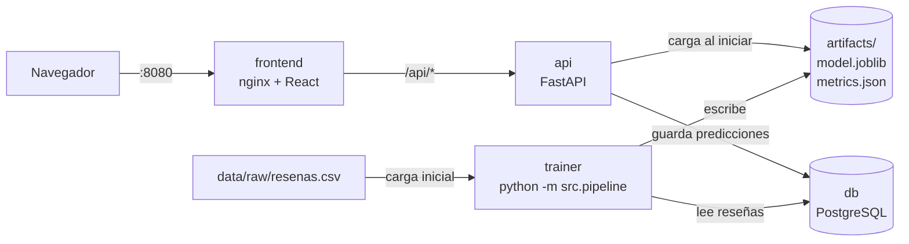

# Opiniómetro

Ejemplo completo del **Proyecto Integrador** de Tópicos y Programación Avanzada: una aplicación web que clasifica el sentimiento de reseñas de restaurantes escritas en español (**negativo, neutro o positivo**) y muestra cómo se procesó cada texto.

Incluye las cinco capas que pide el enunciado, todas en contenedores Docker:

| Capa | Qué hay en este ejemplo | Dónde |
|---|---|---|
| Datos | 3.045 reseñas sintéticas con desbalance, nulos, duplicados, negaciones, ironía y etiquetas ruidosas; guardadas en PostgreSQL | `data/`, `db/`, `src/data/` |
| Pipeline de NLP | normalización, tokenización, stop words ajustadas, stemming y lematización, n-gramas y TF-IDF | `src/nlp/` |
| Modelos | Naive Bayes multinomial y regresión logística, comparados contra una línea base con validación cruzada | `src/models/` |
| Backend | API REST con FastAPI: predicción, lote, métricas, estado e historial | `api/` |
| Frontend | React: analizar un texto, subir un archivo, ver métricas, datos e historial | `frontend/` |

> Los datos son **sintéticos** para que el ejemplo funcione sin Internet y se pueda repetir exactamente. Los proyectos de los grupos deben usar datos reales.

## Arquitectura



`docker compose up` levanta cuatro servicios en este orden:

1. **db**: PostgreSQL. Crea las tablas de `db/init.sql` la primera vez.
2. **trainer**: carga el CSV en la tabla `resenas`, entrena todos los experimentos, guarda el mejor pipeline en `artifacts/` y termina. Si el modelo ya existe, no reentrena.
3. **api**: FastAPI. Arranca solo si el entrenamiento terminó bien y carga `artifacts/model.joblib` una vez.
4. **frontend**: nginx sirve React compilado y reenvía `/api` al contenedor `api`.

## Levantar el sistema desde cero

### Requisitos

- [Docker Desktop](https://www.docker.com/products/docker-desktop/) (Windows o macOS) o Docker Engine con Compose v2 (Linux).
- Unos 3 GB libres. La primera construcción descarga imágenes y librerías (~5 minutos con buena conexión). Las siguientes tardan segundos.

### Pasos

```bash
git clone <url-del-repositorio> opiniometro
cd opiniometro
docker compose up --build
```

Espera la línea `En producción: Regresión logística ...` del contenedor `trainer` (unos 30 segundos) y abre:

| Qué | Dirección |
|---|---|
| Aplicación | http://localhost:8080 |
| Documentación interactiva de la API (Swagger) | http://localhost:8000/api/docs |
| PostgreSQL (DBeaver, pgAdmin…) | `localhost:5433`, usuario, clave y base `opiniometro` |

Para detener: `Ctrl+C`, o `docker compose down` si lo levantaste con `-d`. La base de datos se conserva en el volumen `pgdata`. `docker compose down -v` la borra.

### Si un puerto está ocupado

Crea un archivo `.env` junto a `docker-compose.yml`:

```bash
API_PORT=8001
FRONTEND_PORT=8090
DB_PORT=5434
```

## Uso diario

| Tarea | Comando | Atajo (macOS/Linux) |
|---|---|---|
| Levantar todo en segundo plano | `docker compose up --build -d` | `make up` |
| Reentrenar tras cambiar `params.yaml` o `src/` | `docker compose run --rm trainer python -m src.pipeline` y luego `docker compose restart api` | `make train` |
| Recargar el CSV en PostgreSQL y reentrenar | `docker compose run --rm trainer python -m src.pipeline --reload-data` y luego `docker compose restart api` | `make reload-data` |
| Pruebas automatizadas | `docker compose --profile dev run --rm --build tests` | `make test` |
| Reconstruir el frontend tras cambiar `frontend/` | `docker compose up -d --build frontend` | `make frontend` |
| Notebook de EDA y experimentos | `docker compose --profile dev up --build notebook` → http://localhost:8888 | `make notebook` |
| Ver la base de datos en el navegador | `docker compose --profile tools up -d adminer` → http://localhost:8081 | |
| Ver registros | `docker compose logs -f api trainer` | `make logs` |

`src/`, `api/`, `data/` y `params.yaml` están montados como volúmenes: un cambio en esos archivos no necesita reconstruir la imagen, solo reentrenar o reiniciar la API. Hay que reconstruir (`--build`) solo si cambia `requirements.txt` o el frontend.

### Desarrollo del frontend con recarga automática

```bash
cd frontend
npm install
API_URL=http://localhost:8000 npm run dev
```

Abre http://localhost:5173. Vite reenvía `/api` al backend, igual que nginx en el contenedor.

## Cómo viaja una predicción

1. El usuario escribe una reseña en **Analizar**. React llama a `api.predict()` (`frontend/src/api.js`), que hace `POST /api/predict` con `{"texto": "..."}`.
2. nginx recibe la petición en el puerto 8080 y la reenvía a `http://api:8000` (`frontend/nginx.conf`).
3. FastAPI valida el cuerpo con `PredictRequest` (`api/schemas.py`). Si el texto está vacío, es muy largo o no es un texto, responde **422** con un mensaje en español.
4. `ModelService.predict()` (`api/service.py`) llama a `pipeline.predict_proba()`. El pipeline guardado ejecuta, en orden:
   `TextPreprocessor` (normaliza, tokeniza, quita stop words, aplica stemming) → `TfidfVectorizer` (vocabulario aprendido en el entrenamiento) → `LogisticRegression`.
5. `ModelService.explain()` vuelve a pasar el texto por el mismo `TextPreprocessor` para devolver cada paso intermedio.
6. La predicción se guarda en la tabla `predicciones` de PostgreSQL. Si la base falla, la predicción igual se devuelve.
7. React muestra la clase, las probabilidades y los pasos del preprocesamiento.

El backend **no reimplementa** el preprocesamiento: lo ejecuta el primer paso del pipeline que se guardó al entrenar.

## Resultados

| Modelo | F1 macro (validación cruzada) | Exactitud (prueba) | F1 macro (prueba) |
|---|---|---|---|
| Línea base (siempre «positivo») | 0,217 | 48,3 % | 0,217 |
| Naive Bayes multinomial | 0,857 | 88,9 % | 0,874 |
| **Regresión logística** (en producción) | **0,875** | **89,5 %** | **0,880** |

Configuración en producción: stemming Snowball, lista de stop words ajustada, unigramas + bigramas, `C=2`, `class_weight="balanced"`. El análisis completo está en [el informe técnico](docs/informe_tecnico.md) y en la pestaña **Métricas**.

## Estructura

```text
opiniometro/
├── data/
│   ├── raw/resenas.csv          # datos crudos (sintéticos)
│   └── README.md                # origen, licencia, fecha y diccionario de datos
├── db/init.sql                  # esquema de PostgreSQL
├── notebooks/
│   └── 01_eda_y_experimentos.ipynb
├── src/
│   ├── config.py                # rutas y lectura de params.yaml
│   ├── db.py                    # acceso a PostgreSQL
│   ├── pipeline.py              # un comando: datos → BD → entrenamiento
│   ├── data/
│   │   ├── generate.py          # generador de reseñas sintéticas
│   │   └── prepare.py           # limpieza, EDA y división estratificada
│   ├── nlp/
│   │   └── preprocessing.py     # TextPreprocessor: todos los pasos de NLP
│   └── models/
│       ├── experiments.py       # modelos, búsqueda y pipeline de producción
│       ├── evaluate.py          # métricas, errores y términos influyentes
│       └── train.py             # entrena, compara y guarda
├── api/
│   ├── main.py                  # endpoints y manejo de errores
│   ├── schemas.py               # contratos y validación de entradas
│   └── service.py               # carga del modelo y predicción
├── frontend/                    # React + Vite, servido por nginx
├── tests/                       # pruebas de NLP, entrenamiento y API
├── artifacts/                   # generado: modelo, métricas, experimentos, errores
├── docs/
│   ├── informe_tecnico.md
│   ├── api.md
│   └── modificaciones_en_vivo.md
├── params.yaml                  # todos los parámetros del experimento
├── Dockerfile                   # imagen de Python (entrenamiento y API)
├── docker-compose.yml
├── Makefile                     # atajos opcionales
├── requirements.txt             # versiones exactas
├── requirements-dev.txt         # pruebas y notebook
└── CONTRIBUCIONES.md
```

## Documentación

- [Informe técnico](docs/informe_tecnico.md): problema, dataset, decisiones de NLP, comparación de modelos, errores y arquitectura.
- [API](docs/api.md): endpoints, ejemplos con `curl` y errores.
- [Modificaciones en vivo](docs/modificaciones_en_vivo.md): cómo hacer los cambios de la defensa, paso a paso.
- [Datos](data/README.md): origen y diccionario.

## Problemas habituales

| Situación | Qué hacer |
|---|---|
| `port is already allocated` | Otro programa usa el puerto. Cámbialo en `.env` (ver arriba). |
| `api` no arranca y `trainer` salió con error | `docker compose logs trainer` muestra el motivo. Corrige y vuelve a ejecutar `docker compose up`. |
| Cambié `params.yaml` y la app muestra lo mismo | El modelo se carga al iniciar la API. Reentrena y ejecuta `docker compose restart api`. |
| Cambié el frontend y no veo el cambio | `docker compose up -d --build frontend` y recarga el navegador sin caché. |
| `docker compose up` no reentrena | Es intencional: si `artifacts/model.joblib` existe, se reutiliza. Usa `python -m src.pipeline` sin `--skip-if-trained`. |
| Quiero empezar de cero | `docker compose down -v` y borra el contenido de `artifacts/` (o `make clean`). |
| En Linux, `artifacts/` tiene archivos de `root` | Los crea el contenedor. Bórralos con `sudo` o con `make clean`. |
